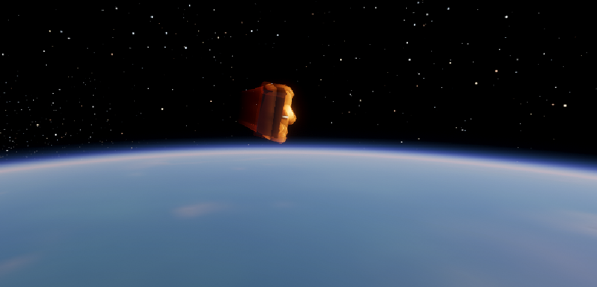

# Pantry Reentry

> Everything burns eventually.

Pantry Reentry is a small Unity game where you pick something that should never
be in space (a fridge, a piano, a bathtub) and watch it fall back through the
atmosphere. You don't steer anything. You pick the object, press play, and then
you get the best seat in the house for however long it survives.

The name is a bad rhyme. I know. I couldn't find a better one.

The whole point was to make reentry look as good as the Firefly effects in
Kerbal Space Program, and then ruin that dignity by putting a toilet in it.



## What you actually do

1. Start the game. The title screen has a slowly spinning object on the right
   and the menu on the left.
2. Hit PLAY and pick something from the list.
3. It fades out and you're up at the edge of space, looking at the object with
   the planet curving away below it.
4. It falls. The air gets thicker, the plasma starts, the camera shakes,
   and sooner or later the thing either comes apart or it doesn't.
5. A results screen tells you how it went and gives you a grade.
6. Drop it again, or go back to the menu and try something heavier.

That's the whole game. It's a toy more than a game, and I'm fine with that.

## The objects

There are eight so far. Each one has its own mass, size, heat capacity and
failure temperature, so they really do behave differently.

| Object          | Mass   | Toughness | Notes                                                    |
|-----------------|--------|-----------|----------------------------------------------------------|
| Fridge          | 90 kg  | Medium    | The classic. Big, boxy, takes a lot of heat before it goes. |
| Chair           | 7 kg   | Very low  | Light and fragile. Gone almost immediately.               |
| Shelf of Beans  | 150 kg | Medium    | A shelf. Stocked with beans. Tumbles slowly.              |
| Toilet          | 40 kg  | Medium    | Ceramic, so it holds up better than you'd hope.           |
| Upright Piano   | 250 kg | Low       | Huge and heavy, but it breaks apart fast.                 |
| Washing Machine | 75 kg  | Medium    | Decent heat capacity. Spins as it falls.                  |
| Traffic Cone    | 4 kg   | Very low  | Light, orange, and completely unprepared.                 |
| Bathtub         | 120 kg | High      | Cast iron. Probably your best bet.                        |

The stats in the table are the ones shown on the selection cards. The real
numbers (drag, nose radius, heat capacity, tumble rate) live in
`ReentryObject.cs` if you want to see how they were set.

## Grades

The grade depends on how high up the object was when it gave up.

| Grade | What happened                                         |
|-------|-------------------------------------------------------|
| F     | Vaporised above 85 km. It barely touched the air.      |
| D     | Lasted about a second in the glow (70 to 85 km).       |
| C     | A decent show, came apart between 50 and 70 km.        |
| B     | Fought hard, lost between 30 and 50 km.                |
| A     | Made it below 30 km before breaking up.                |
| S     | Survived the whole way down.                           |

If something does reach the ground, the verdict also depends on how fast it
was going when it got there. Fast means flat.

## Controls

| Input                              | Does                              |
|------------------------------------|-----------------------------------|
| Left or right mouse button + drag  | Orbit the camera around the object |
| Scroll wheel                       | Zoom in and out                   |
| R                                  | Reset the camera                  |

It's a watching game, so that's all of it. Everything else is menus.

## Settings

Reachable from the title screen. Everything is saved between sessions.

- Master volume, music and effects (separate sliders)
- Camera shake, from 0 to 150 percent
- Terrain detail on or off
- Fullscreen
- VSync
- Frame rate limit (none, 30, 60, 120)

The terrain detail switch is there because that effect costs the most on weak
graphics cards. If the game is struggling, turn that off first.

## How it works

I'm going to explain this at the level I would to a friend, not as a paper.

**The fall is faked, on purpose.** The object never actually moves. It sits at
the origin of the scene while the simulation keeps track of its altitude and
speed. The planet's position is updated each frame so it's always the right
distance below. That keeps everything numerically sane, since nothing ever
travels 100 km in game units.

**Heating.** Each object has a heat model. Air density rises as altitude drops,
speed and density set how hard it's being heated, and the surface temperature
climbs until it either survives, loses material, or crosses its failure
temperature and breaks. The glow, shake and sound are all driven by that same
number, so they always agree with each other.

**The plasma.** The glowing shell is a set of shaders wrapped around the actual
shape of the object. A second effect draws the wake streaming behind it. Colour
goes from dull red through orange to blue-white as the heat goes up. It's all
generated in shaders, with no particle texture work.

**Breakup.** When an object fails, it splits into burning fragments, and each
one throws a backward-pointing streak. The pieces fade out as they burn away.

**The planet.** It is generated when the game starts. A noise function builds
continents, ice caps and ocean, and the result is baked into a cubemap that
HDRP's physically based sky uses as the ground. A seed controls which planet you
get. There is a second pass, a custom full-screen shader, that adds finer
terrain and mountain shading as you get closer. Without it, anything under
about 100 km looks blurry.

**The sound.** There are no audio files in this project. The menu song, the
plasma roar, the crackle, the explosion and the click sounds are all
synthesised in code when the game launches. If you open the folder looking for
`.wav` files, they aren't there.

**The menu previews.** The little spinning objects on the selection cards are
real copies of the objects, placed far away from the scene on their own layer,
each with a tiny camera rendering to a texture.

## Requirements

- Unity 6 with the High Definition Render Pipeline (HDRP)
- Windows is what I've built and tested on
- A graphics card that can run HDRP. It works on integrated graphics, just not
  at high settings. This was developed on a laptop without a dedicated GPU.

**This will not run in a browser.** Unity's web builds don't support HDRP, and
the planet generator uses threads, which browsers don't allow. A web version
would need most of the visuals rebuilt, so there isn't one.

## Setting it up

This repo holds the scripts and shaders. It is not a complete Unity project on
its own unless you also include the scene and project settings, so check that
the files you need are here.

1. Make a new Unity 6 project using the HDRP template.
2. Copy the `Scripts` and `Shaders` folders into your project's `Assets` folder.
3. Open the scene, or build one: an object with the Reentry scripts on it, a
   Main Camera with the orbit and effects scripts, and one empty object called
   Sky with the Reentry Sky script on it.
4. Add the scene to Build Settings.
5. Press Play.

If the planet looks flat blue, check the Console. The sky script prints what it
is doing and why it failed, if it did.

## Project layout

```
Scripts/
  ReentryBody.cs          heat and flight simulation (not in this repo, see note below)
  ReentryObject.cs        the eight objects and their stats
  ReentryPlasma.cs        plasma glow
  ReentryPlasmaWrap.cs    plasma shell and wake around the object
  ReentryBreakup.cs       breaking into fragments
  ReentryPiece.cs         one burning fragment
  ReentryTrail.cs         trails behind falling pieces
  ReentryOrbitCamera.cs   the camera you drag and zoom
  ReentryCameraFX.cs      shake and firelight
  ReentrySky.cs           planet, atmosphere, sun, exposure
  ReentryPlanetGen.cs     generates the planet picture
  ReentryPlanetDetail.cs  the extra terrain detail pass
  ReentryStars.cs         procedural star field
  ReentryShaders.cs       finds shaders (reads them from a list that is always in builds)
  ReentryShaderList.cs    the list of shaders
  ReentryDiagnostics.cs   on-screen check for missing shaders (F3), delete when finished
  Editor/
    ReentryShaderInclude.cs  builds the shader list before each build
  ReentryAudio.cs         all the sound, generated in code
  ReentryMenu.cs          title, selection and settings screens
  ReentryResults.cs       the end-of-fall screen
  ReentrySettings.cs      saved player settings
Shaders/
  plasma shell, wake, wrap, particle, streak, stars,
  planet detail, and a small cubemap test shader
```

`ReentryBody.cs` is the physics script that sits on the object itself. It was
written earlier in the project and isn't in this folder, so add yours before
building.

## Tweaking things

Most settings are in the Inspector on the Sky object.

- **Seed** gives a different planet.
- **Land Amount** changes how much of it is continent.
- **Start Latitude / Longitude / Heading** choose where you fall.
- **Scroll Planet** and **Scroll Multiplier** control how fast the ground slides
  past. Turn the multiplier up if it feels too slow.
- **Reverse Scroll** and **Invert Rotation** exist because I couldn't be sure
  which way HDRP turns the planet. If the ground goes the wrong way, tick one.
- **Sun Elevation** below zero puts you over the night side, where the city
  lights are.
- **Exposure EV** is a quick way to make the whole scene brighter or darker.

On the menu there are offsets for nearly everything (title position, card
position, results position), because I kept moving things around until they
looked right on my screen.

## Adding your own object

1. Add a name to the `Kind` list in `ReentryObject.cs`. Put it at the **end**.
   Unity stores these as numbers, and putting one in the middle shifts all the
   saved ones after it.
2. Write a builder for it. The existing ones are built out of cubes, cylinders
   and spheres, and are a few lines each.
3. Add a preset with its mass, area, drag, nose radius, heat capacity, failure
   temperature and tumble rate.
4. Add a line for it in the card list in `ReentryMenu.cs`.
5. Add its display name in `ReentryResults.cs`.

## Known problems

- **No clouds.** I tried painted ones and 3D volumetric ones. The flat ones
  looked fake and the 3D ones looked like white dots, so I took them out. The
  planet is cleaner without them, but it is missing something.
- **Soft coastlines.** The terrain detail only works on land. Where land meets
  sea, the edge is still limited by the size of the planet picture.
- **Generation time.** The planet is generated on launch, with a quick low
  resolution one first and a sharper one a moment later. You may see it
  sharpen.
- **Memory.** Raising the planet resolution above 1024 gets heavy quickly.
- **Mostly tested in the editor.** Not every setting has been tried in every
  kind of build.

## Ideas that didn't make it

Things I thought about and didn't do, in case you want to:

- A ground impact: flash, shockwave, dust, and a crater shaped like the object
- Personal bests per object
- Betting on whether it survives before you drop it
- A parachute you can deploy
- Proper 3D models instead of shapes built from cubes


## note
I used AI to grammar check, spelling check, bold  words, add lines, etc. to this readme. the writing is still my own.
